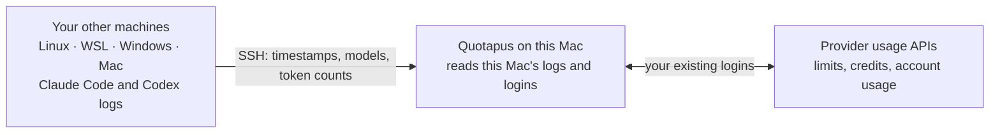

<div align="center"><a name="readme-top"></a>


# Quotapus

**Every AI coding limit — on every machine you code on.**

A macOS menu-bar app for Claude, Codex, Cursor, and 8 more providers.<br>
It also counts the usage on your Linux servers, WSL, Windows PCs, and other Macs.

**English** · [繁體中文](README.zh-TW.md) · [Docs](docs/README.md) · [Changelog](CHANGELOG.md)

[![Download for macOS][download-shield]][download-link]

[![Release][release-shield]][download-link]
[![macOS 15+][macos-shield]][download-link]
[![MIT License][license-shield]](LICENSE)
[![No analytics][privacy-shield]](docs/privacy.md)

<br>

<picture>
  <source media="(prefers-color-scheme: dark)" srcset="docs/media/demo-dark.webp" type="image/webp">
  <source media="(prefers-color-scheme: light)" srcset="docs/media/demo-light.webp" type="image/webp">
  
</picture>

<sub>Recorded in demo mode: the real app, showing sample data.</sub>

</div>

<details>
<summary><kbd>Contents</kbd></summary>

- [Why Quotapus](#why-quotapus)
- [How It Works](#how-it-works)
- [Install](#install)
- [Supported Providers](#supported-providers)
- [Features](#features)
- [FAQ](#faq)
- [Known Limitations](#known-limitations)
- [Similar Projects](#similar-projects)
- [Contributing](#contributing)
- [Building](#building)

</details>

## Why Quotapus

<table>
  <tr>
    <td width="50%" valign="top">
      
      <h3>Every machine, one panel</h3>
      Claude Code and Codex on a Linux server, in WSL, or on another Mac count too. Quotapus pulls them in over the SSH keys you already use: nothing to install on the other machine but Python 3.
    </td>
    <td width="50%" valign="top">
      
      <h3>See one machine, or all of them</h3>
      <b>Usage From</b> switches every history row and live card between all devices, this Mac, or a single machine. Use Tailscale? <b>Add Device</b> lists your tailnet and fills the form in one click.
    </td>
  </tr>
  <tr>
    <td width="50%" valign="top">
      
      <h3>Know before you hit the limit</h3>
      Session, weekly, and model limits with reset countdowns. Pace notes warn when the current speed runs out before the reset, and your top metrics can live right in the menu bar.
    </td>
    <td width="50%" valign="top">
      
      <h3>Live speed and daily totals</h3>
      Tokens per minute with an estimated cost per hour, plus Tokens, Spend, and Models cards for today, yesterday, and the last 30 days.
    </td>
  </tr>
</table>

**Private by design.** No analytics and no account. Credentials stay where your tools already keep them. From another machine, only usage metadata comes back (timestamps, model names, token counts) and this Mac keeps just the daily summaries; prompts and replies never leave that machine. See [Privacy & usage data](docs/privacy.md) and [Remote Devices](docs/remote-devices.md).

## How It Works



- **Limits and account usage** come from each provider's own API, so they already include every machine on that account. Cursor's history is account-wide too.
- **Spend, tokens, and live speed** for Claude Code and Codex come from the logs on each machine. This Mac reads its own; other machines send theirs through Remote Devices.
- **What crosses the wire** is usage metadata only. Prompts, replies, and raw log lines never leave the machine they were written on.

## Install

1. Download the latest `Quotapus-<version>.dmg` from [Releases][download-link] and drag **Quotapus** into **Applications**.
2. Open it once. Quotapus is signed with its own certificate rather than an Apple Developer ID, so macOS says it can't verify the developer. Open **System Settings → Privacy & Security**, scroll to the message about Quotapus, and click **Open Anyway**. This is needed only the first time.
3. If you use Claude Desktop, macOS asks for your Mac login password so Quotapus can read **Claude Safe Storage**, the key Claude Desktop encrypts its login with. Quotapus only reads it to show that account's usage, never changes it, and never sees your password. Choose **Always Allow**; macOS asks again after each Quotapus update. Choose **Deny** if you only use Claude Code.
4. After that, Quotapus checks this repository for new versions about once an hour and offers to install them (see [Updates](docs/updates.md)).

Requires macOS 15 (Sequoia) or later. You can also build it yourself (see [Building](#building)).

### Add Another Machine

Open **Settings → Remote Devices → Add Device**, pick the machine (or type its SSH host), choose its system (Linux, Mac, Windows, or Windows + WSL), and click **Add Device**. Quotapus checks the connection and the logs before it saves. The details, including WSL distributions and troubleshooting, are in [Remote Devices](docs/remote-devices.md).

## Supported Providers

| Provider | What it tracks |
| --- | --- |
| **[Claude](docs/providers/claude.md)** | Session, weekly, model-specific limits, extra usage, local daily spend |
| **[Codex](docs/providers/codex.md)** | Session, weekly, credits, local daily spend |
| **[Cursor](docs/providers/cursor.md)** | Credits, total usage, Grok Bot, Cursor Models, Other Models, requests, on-demand, per-day spend |
| **[Antigravity](docs/providers/antigravity.md)** | Shared Gemini and Claude pool quotas, 5-hour and weekly windows |
| **[Copilot](docs/providers/copilot.md)** | AI credits, extra usage, organization billing, chat and completions |
| **[Devin](docs/providers/devin.md)** | Weekly and daily quota, extra usage balance |
| **[Grok](docs/providers/grok.md)** | Weekly shared pool, pay-as-you-go, local daily spend |
| **[Ollama](docs/providers/ollama.md)** | Ollama Cloud monthly credits (or session and weekly limits on legacy plans), purchased credits |
| **[OpenCode](docs/providers/opencode.md)** | Go session/weekly/monthly caps, Zen spend, local daily spend |
| **[OpenRouter](docs/providers/openrouter.md)** | Credit balance, daily/weekly/monthly spend (API key) |
| **[Z.ai](docs/providers/zai.md)** | Session, weekly, web-search quotas (GLM Coding Plan, API key) |

Most providers read the credentials already on your machine (keychain, auth files, app state), so there's no extra login. OpenRouter and Z.ai are the exceptions: they have no local credential to reuse, so you supply an API key (see [OpenRouter setup](docs/providers/openrouter.md) or [Z.ai setup](docs/providers/zai.md)). Credentials are used only for the corresponding provider requests. Remote Devices import Claude Code and Codex history.

## Features

- **Menu bar pins.** Pin metrics to the menu bar (up to 2 per provider); render as compact text or mini bars. The strip hides metrics with no data instead of showing placeholders.
- **Dashboard popover.** Provider-grouped meters with live reset countdowns and pace indicators. Click usage or reset values to flip their display everywhere; right-click a row to hide or star it, refresh its provider, or open Customize.
- **Live cards.** Activity (live tokens/min, with an estimated cost per hour), Tokens, Spend, and Models — one line each, opened with a click, each with its own Today / Yesterday / 30 Days view.
- **[Remote Devices](docs/remote-devices.md).** Linux servers, other Macs, Windows PCs, and WSL over SSH, with a Tailscale machine picker. A remote machine's speed updates with each import (every refresh).
- **Global shortcut.** Toggle the popover from anywhere — record any combo in Settings.
- **Customize.** Turn providers and metrics on or off, choose which rows stay Always Visible or On Demand, and drag-reorder both.
- **Stale-while-revalidate.** Cached values display instantly at launch; refresh runs every 5 minutes.
- **[Local HTTP API](docs/local-http-api.md).** Other apps can read machine-friendly limits from `127.0.0.1:6741/v1/limits`. It is loopback-only and never serves credentials; note that browser pages can read it too — see the [privacy note](docs/local-http-api.md#cors-and-privacy).
- **[Proxy support](docs/proxy.md)** and **[extra local log folders](docs/local-log-roots.md).**
- **Native settings.** Launch at login, global shortcut, icon style, theme, density — see [Settings](docs/settings.md).

<details>
<summary><b>How Quotapus differs from OpenUsage</b></summary>

<br>

Quotapus started from [OpenUsage](https://github.com/robinebers/openusage)'s code and has since gone its own way in design and features.

- **Different app, side by side.** Quotapus has its own bundle ID (`com.livejiaquan.quotapus`), settings, logs (`~/Library/Logs/Quotapus`), config folder (`~/.quotapus`, `~/.config/quotapus`), and local API port (`6741`), so it can be installed next to the official app without either touching the other.
- **Remote Devices and live cards** are Quotapus additions.
- **No analytics.** Quotapus contains no analytics or crash-reporting code, so it sends no usage statistics anywhere.
- **No iCloud Sync, no command-line helper, no share images.** Remote Devices covers other machines over SSH; the rest was removed to keep the app small.
- **Pricing stays local.** Model prices come from LiteLLM, models.dev, and a price list bundled with the app — nothing is fetched from OpenUsage.
- **Updates come from this repository**, not from OpenUsage's update feed.

</details>

## FAQ

<details>
<summary><b>Is it safe to give Quotapus SSH access to my machines?</b></summary>

<br>

Quotapus uses your existing `~/.ssh/config` and keys and never stores a password. Each refresh it streams a small bundled Python parser over SSH stdin; the parser reads the Claude Code and Codex log folders and returns timestamps, model names, token counts, and deduplication IDs. It keeps a private cache of parsed events on that machine (`~/.cache/quotapus-remote`) so the next import is quick. See [Remote Devices](docs/remote-devices.md).

</details>

<details>
<summary><b>Why does macOS make me click "Open Anyway"?</b></summary>

<br>

Quotapus is signed with its own certificate, not an Apple Developer ID, so Gatekeeper can't verify the developer. You confirm it once in **System Settings → Privacy & Security**; updates keep working after that.

</details>

<details>
<summary><b>Why does it ask for my Mac password?</b></summary>

<br>

Only if you use Claude Desktop: macOS is asking whether Quotapus may read **Claude Safe Storage**, the key Claude Desktop encrypts its login with. Quotapus reads it to show that account's usage and never sees your password. macOS asks again after each Quotapus update. Choose **Deny** if you only use Claude Code.

</details>

<details>
<summary><b>Does it count Cursor (or my plan limits) on my other machines?</b></summary>

<br>

Yes. Cursor's usage and every provider's limit meters come from the provider's account, so they already include all your machines. Remote Devices brings in the history that only lives in each machine's log files; today that's Claude Code and Codex.

</details>

<details>
<summary><b>Why are costs marked "estimated"?</b></summary>

<br>

Subscriptions aren't billed per token, so Quotapus prices the tokens in your logs at public API rates to show what that usage is worth. See [Model pricing](docs/pricing.md).

</details>

<details>
<summary><b>Does Quotapus send anything about me?</b></summary>

<br>

No analytics and no crash reports. It talks to the provider APIs you use, downloads public model price lists from LiteLLM and models.dev about once an hour, and checks this repository for updates. See [Privacy & usage data](docs/privacy.md).

</details>

<details>
<summary><b>Can I run it next to OpenUsage?</b></summary>

<br>

Yes. Quotapus has its own bundle ID, settings, logs, and local API port, so the two never touch each other.

</details>

## Known Limitations

- **No Apple Developer ID yet.** The first launch needs **Open Anyway**, and Claude Desktop users approve Claude Safe Storage again after each update.
- **Remote Devices import Claude Code and Codex.** OpenCode, Grok, and Antigravity spend still counts only this Mac (their limits are account-wide, so those meters are complete).
- **A remote machine's speed is a snapshot** from its last import (every refresh, about 5 minutes), not a live feed.
- **Remote machines need SSH and Python 3.** macOS 15 or later on this Mac.

## Similar Projects

- **[OpenUsage](https://github.com/robinebers/openusage)**, the app Quotapus is built on. It syncs history between your Macs over iCloud and has a command-line helper.
- **[CodexBar](https://github.com/steipete/CodexBar)** tracks over a hundred providers, with a Linux desktop app and a CLI.

Quotapus adds one thing: the Linux servers and WSL boxes you SSH into, counted in the same panel as your Mac.

## Contributing

Bug reports, provider requests, and pull requests are welcome. Start with [CONTRIBUTING.md](CONTRIBUTING.md); adding a provider is a small, self-contained module (see [adding a provider](docs/adding-a-provider.md)). If Quotapus saves you from a surprise rate limit, a star helps other people find it.

## Documentation

Behavior docs live in [docs/](docs/README.md). Developer docs: [architecture](docs/architecture.md), [adding a provider](docs/adding-a-provider.md), [debugging & capturing logs](docs/debugging.md), and [demo mode](docs/demo-mode.md) (sample data for screenshots).

## Building

```sh
swift build                 # debug build
swift test                  # run the test suite
./script/build_and_run.sh   # build and launch dist/Quotapus.app (no install)
```

Internal module and type names keep OpenUsage's spelling on purpose, so changes from upstream merge cleanly. Everything a user sees reads from `Sources/OpenUsage/Support/AppBrand.swift`. The app icon lives in `assets/QuotapusIcon` (see its README).

<details>
<summary><b>Releasing</b> (maintainers)</summary>

<br>

Pushing a `v*` tag runs [.github/workflows/release.yml](.github/workflows/release.yml), which builds a universal app, signs it, publishes `Quotapus-<version>.dmg` on GitHub Releases, and updates the Sparkle appcast on this repository's GitHub Pages (`https://livejiaquan.github.io/quotapus/appcast.xml`). A tag with a suffix such as `v1.1.0-beta.1` goes to the Beta Updates channel; a plain tag goes to everyone. Run the workflow by hand with **dry_run** to build and sign a DMG as a run artifact without publishing anything.

It needs these repository secrets (Settings → Secrets and variables → Actions):

| Secret                           | What it is                                                                 |
| -------------------------------- | -------------------------------------------------------------------------- |
| `CODESIGN_CERTIFICATE`           | base64 of the "Quotapus Code Signing" `.p12` (or a Developer ID `.p12`)    |
| `CODESIGN_CERTIFICATE_PASSWORD`  | the password of that `.p12`                                                |
| `SPARKLE_PUBLIC_KEY`             | base64 Ed25519 public key, baked into the build as `SUPublicEDKey`         |
| `SPARKLE_PRIVATE_KEY`            | base64 Ed25519 private key (32-byte seed) that signs each DMG for Sparkle  |
| `APPLE_ID`, `APPLE_PASSWORD`, `APPLE_TEAM_ID` | optional; only with a Developer ID certificate, for notarization |

Releases are signed with Quotapus's own self-signed certificate, the same for every release; the first launch needs one **Open Anyway** (see Installation), and Claude Desktop users approve **Claude Safe Storage** again after each update (macOS ties that approval to each build of an app without a Developer ID). A Developer ID certificate plus the `APPLE_*` secrets removes both. **Never lose or regenerate the certificate or the Sparkle private key**: installed copies only accept updates signed by the same Sparkle key, and a new certificate would change the app's identity for every user. Keep offline backups of both. GitHub Pages must use **GitHub Actions** as its source, and [.github/workflows/deploy-pages.yml](.github/workflows/deploy-pages.yml) must be on `main`.

</details>

## Credits, License, and Trademark

Quotapus is built on [OpenUsage](https://github.com/robinebers/openusage), created by Robin Ebers and maintained with Mert and David. The code is under the [MIT license](LICENSE), which keeps the original copyright notice.

> [!NOTE]
> Quotapus is an unofficial fork of OpenUsage. It is not the official OpenUsage app and is not endorsed by its maintainers. Report problems with Quotapus [here](https://github.com/livejiaquan/quotapus/issues), not to the OpenUsage project.

"OpenUsage" and its logo are trademarks of Robin Ebers (see [TRADEMARK.md](TRADEMARK.md)). Per that policy, this fork uses its own name and icon and doesn't claim to be the official project.

<div align="right"><a href="#readme-top">Back to top ↑</a></div>

[download-link]: https://github.com/livejiaquan/quotapus/releases/latest
[download-shield]: https://img.shields.io/badge/Download_for_macOS-7357FF?style=for-the-badge&logo=apple&logoColor=white
[release-shield]: https://img.shields.io/github/v/release/livejiaquan/quotapus?style=flat-square&color=7357FF&labelColor=121028&label=release
[macos-shield]: https://img.shields.io/badge/macOS-15%2B-8F78FF?style=flat-square&logo=apple&logoColor=white&labelColor=121028
[license-shield]: https://img.shields.io/badge/license-MIT-A491FF?style=flat-square&labelColor=121028
[privacy-shield]: https://img.shields.io/badge/analytics-none-F2F0FF?style=flat-square&labelColor=121028
