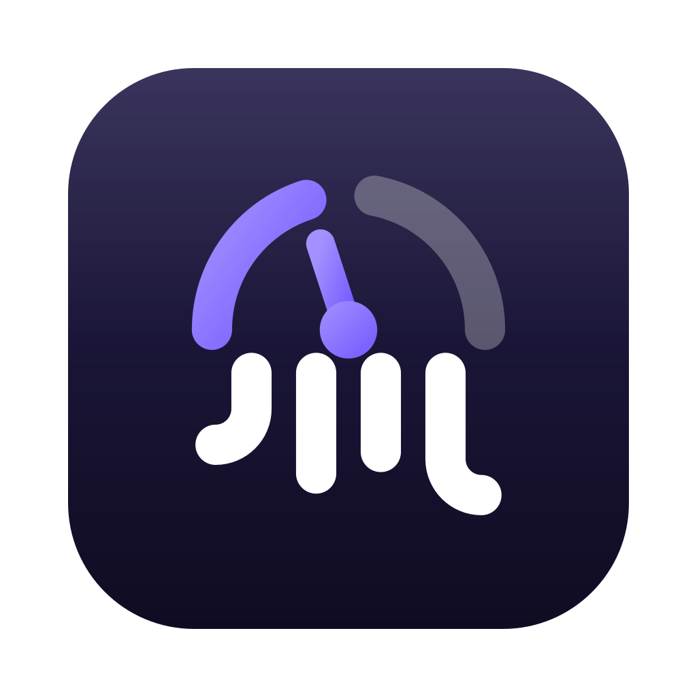
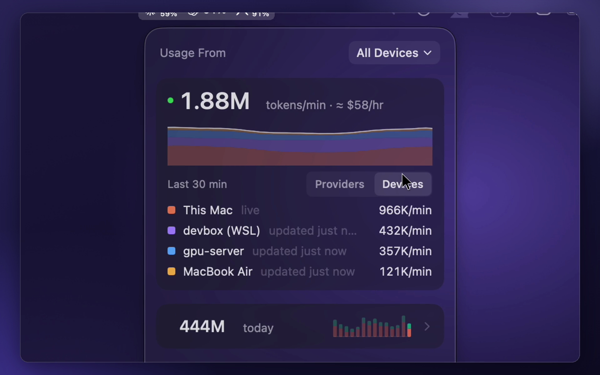
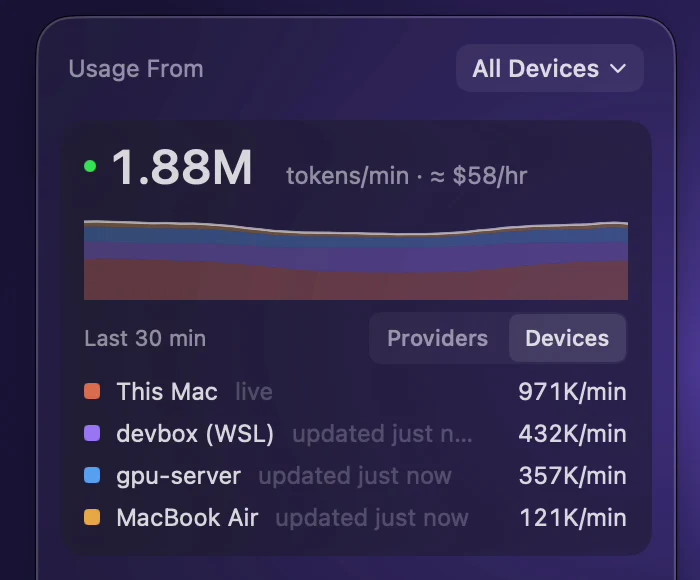
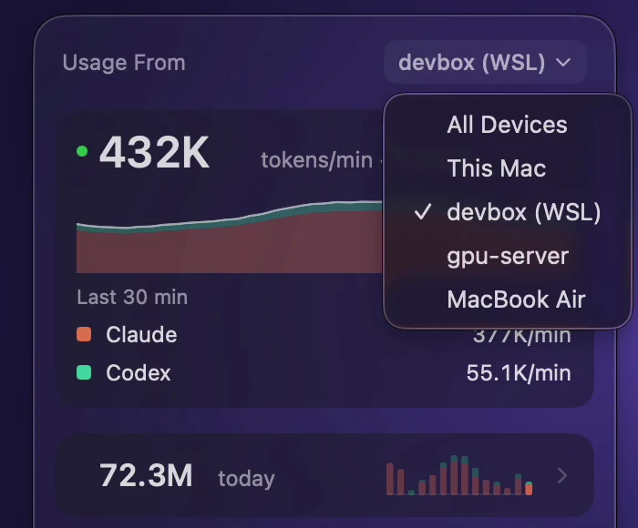
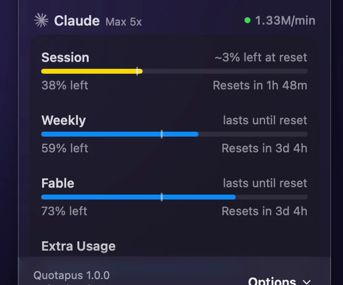
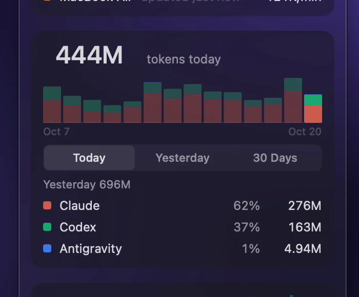
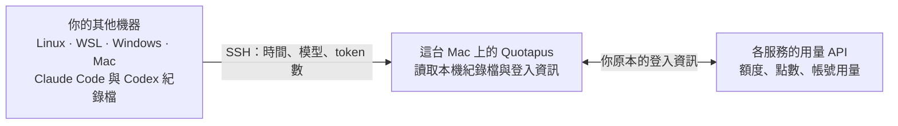

<div align="center"><a name="readme-top"></a>



# Quotapus

**每一台寫程式的機器，所有 AI 額度一次看清楚。**

macOS 選單列小工具，支援 Claude、Codex、Cursor 等 11 家服務。<br>
連 Linux 伺服器、WSL、Windows 電腦和其他 Mac 上的用量也一起算進來。

[English](README.md) · **繁體中文** · [說明文件](docs/README.md) · [更新紀錄](CHANGELOG.md)

[![下載 macOS 版][download-shield]][download-link]

[![Release][release-shield]][download-link]
[![macOS 15+][macos-shield]][download-link]
[![MIT License][license-shield]](LICENSE)
[![No analytics][privacy-shield]](docs/privacy.md)

<br>

<picture>
  <source media="(prefers-color-scheme: dark)" srcset="docs/media/demo-dark.webp" type="image/webp">
  <source media="(prefers-color-scheme: light)" srcset="docs/media/demo-light.webp" type="image/webp">
  
</picture>

<sub>以示範模式錄製：真正的 App，顯示的是示範資料。</sub>

</div>

<details>
<summary><kbd>目錄</kbd></summary>

- [為什麼選 Quotapus](#為什麼選-quotapus)
- [運作原理](#運作原理)
- [安裝](#安裝)
- [支援的服務](#支援的服務)
- [功能](#功能)
- [常見問題](#常見問題)
- [已知限制](#已知限制)
- [同類專案](#同類專案)
- [參與貢獻](#參與貢獻)
- [編譯](#編譯)

</details>

## 為什麼選 Quotapus

<table>
  <tr>
    <td width="50%" valign="top">
      
      <h3>所有機器，一個面板</h3>
      在 Linux 伺服器、WSL 或另一台 Mac 上跑的 Claude Code 和 Codex 也算得到。Quotapus 用你現有的 SSH 金鑰把用量抓回來，另一台機器只要有 Python 3，不用另外安裝任何東西。
    </td>
    <td width="50%" valign="top">
      
      <h3>想看一台、還是全部，都可以</h3>
      <b>Usage From</b> 可以把所有歷史數字和即時卡片切換成全部設備、這台 Mac 或某一台機器。有用 Tailscale 的話，<b>Add Device</b> 會直接列出你網路裡的機器，點一下就填好。
    </td>
  </tr>
  <tr>
    <td width="50%" valign="top">
      
      <h3>撞牆之前就先知道</h3>
      Session、每週和各模型的額度，加上重置倒數。照目前速度會在重置前用完時，會提前提醒你；最重要的數字還能直接釘在選單列上。
    </td>
    <td width="50%" valign="top">
      
      <h3>即時速度與每日總量</h3>
      每分鐘 token 數和預估每小時花費，另外還有 Tokens、Spend、Models 卡片，可以看今天、昨天和最近 30 天。
    </td>
  </tr>
</table>

**隱私優先。** 沒有任何數據追蹤，也不用註冊帳號。登入資訊留在各個工具原本存放的地方。從其他機器只會傳回用量資料（時間、模型名稱、token 數），這台 Mac 只保存每日統計；提示詞和回覆永遠不會離開那台機器。詳見 [Privacy & usage data](docs/privacy.md) 與 [Remote Devices](docs/remote-devices.md)。

## 運作原理



- **額度與帳號用量**來自各服務自己的 API，本來就包含同一個帳號底下的所有機器。Cursor 的歷史也是整個帳號一起算。
- **Claude Code 與 Codex 的花費、token 數和即時速度**來自每台機器的紀錄檔。這台 Mac 讀自己的，其他機器透過 Remote Devices 傳過來。
- **傳輸的只有用量資料**。提示詞、回覆和原始紀錄內容，永遠不會離開寫下它們的那台機器。

## 安裝

1. 到 [Releases][download-link] 下載最新的 `Quotapus-<版本>.dmg`，把 **Quotapus** 拖進 **應用程式**。
2. 第一次打開。Quotapus 用的是自己的簽署憑證，不是 Apple Developer ID，所以 macOS 會說無法驗證開發者。到 **系統設定 → 隱私權與安全性**，找到 Quotapus 的訊息，按 **強制打開**。只有第一次需要。
3. 如果你有用 Claude Desktop，macOS 會要你輸入 Mac 登入密碼，讓 Quotapus 讀取 **Claude Safe Storage**（Claude Desktop 用來加密登入資訊的金鑰）。Quotapus 只會讀它來顯示該帳號的用量，不會修改，也看不到你的密碼。請選 **永遠允許**；每次 Quotapus 更新後 macOS 會再問一次。只用 Claude Code 的話選 **拒絕** 即可。
4. 之後 Quotapus 大約每小時檢查一次這個 repo 有沒有新版本，有的話會提示你安裝（見 [Updates](docs/updates.md)）。

需要 macOS 15（Sequoia）以上。也可以自己編譯（見 [編譯](#編譯)）。

### 加入另一台機器

打開 **Settings → Remote Devices → Add Device**，選擇機器（或輸入它的 SSH 主機名稱），選系統（Linux、Mac、Windows 或 Windows + WSL），按 **Add Device**。Quotapus 會先檢查連線和紀錄檔再儲存。WSL 發行版、疑難排解等細節請看 [Remote Devices](docs/remote-devices.md)。

## 支援的服務

| 服務 | 追蹤項目 |
| --- | --- |
| **[Claude](docs/providers/claude.md)** | Session、每週、各模型額度、額外用量、本機每日花費 |
| **[Codex](docs/providers/codex.md)** | Session、每週、點數、本機每日花費 |
| **[Cursor](docs/providers/cursor.md)** | 點數、總用量、Grok Bot、Cursor 模型、其他模型、請求數、隨用隨付、每日花費 |
| **[Antigravity](docs/providers/antigravity.md)** | Gemini 與 Claude 共用額度、5 小時與每週區間 |
| **[Copilot](docs/providers/copilot.md)** | AI 點數、額外用量、組織帳單、對話與自動完成 |
| **[Devin](docs/providers/devin.md)** | 每週與每日額度、額外用量餘額 |
| **[Grok](docs/providers/grok.md)** | 每週共用額度、隨用隨付、本機每日花費 |
| **[Ollama](docs/providers/ollama.md)** | Ollama Cloud 每月點數（舊方案為 Session 與每週額度）、購買的點數 |
| **[OpenCode](docs/providers/opencode.md)** | Go 的 Session／每週／每月上限、Zen 花費、本機每日花費 |
| **[OpenRouter](docs/providers/openrouter.md)** | 點數餘額、每日／每週／每月花費（需 API key） |
| **[Z.ai](docs/providers/zai.md)** | Session、每週、網路搜尋額度（GLM Coding Plan，需 API key） |

大部分服務直接讀取你電腦上已有的登入資訊（鑰匙圈、設定檔、App 狀態），不用再登入一次。OpenRouter 和 Z.ai 例外：它們沒有可沿用的本機登入資訊，需要你提供 API key（見 [OpenRouter 設定](docs/providers/openrouter.md)、[Z.ai 設定](docs/providers/zai.md)）。登入資訊只會用在對應服務的請求上。Remote Devices 匯入的是 Claude Code 和 Codex 的使用紀錄。

## 功能

- **選單列釘選。** 把指標釘在選單列上（每個服務最多 2 個），可顯示為精簡文字或迷你長條；沒有資料的指標會自動隱藏。
- **儀表板面板。** 依服務分組的額度條，附即時重置倒數和速度提示。點用量或重置時間可以切換顯示方式；在列上按右鍵可以隱藏、加星號、重新整理或打開 Customize。
- **即時卡片。** Activity（每分鐘 token 數與預估每小時花費）、Tokens、Spend、Models，各一行，點開看細節，每張都能切換今天／昨天／30 天。
- **[Remote Devices](docs/remote-devices.md)。** 透過 SSH 連 Linux 伺服器、其他 Mac、Windows 電腦和 WSL，還有 Tailscale 機器選擇器。遠端機器的速度會在每次匯入（每次重新整理）時更新。
- **全域快捷鍵。** 隨時開關面板，在 Settings 裡設定任意組合鍵。
- **Customize。** 開關服務與指標、決定哪些列常駐顯示（Always Visible）或收起來（On Demand），兩者都能拖曳排序。
- **先顯示快取、再背景更新。** 啟動時立刻顯示快取數值，每 5 分鐘重新整理一次。
- **[本機 HTTP API](docs/local-http-api.md)。** 其他 App 可以從 `127.0.0.1:6741/v1/limits` 讀取額度資料。只在本機開放、絕不提供登入資訊；但瀏覽器網頁也讀得到，請見[隱私說明](docs/local-http-api.md#cors-and-privacy)。
- **[Proxy 支援](docs/proxy.md)**與**[額外的本機紀錄資料夾](docs/local-log-roots.md)。**
- **原生設定。** 開機自動啟動、全域快捷鍵、圖示樣式、主題、密度，見 [Settings](docs/settings.md)。

<details>
<summary><b>Quotapus 和 OpenUsage 有什麼不同</b></summary>

<br>

Quotapus 從 [OpenUsage](https://github.com/robinebers/openusage) 的程式碼出發，之後在設計和功能上走了自己的路。

- **是另一個 App，可以並存。** Quotapus 有自己的 Bundle ID（`com.livejiaquan.quotapus`）、設定、紀錄檔（`~/Library/Logs/Quotapus`）、設定資料夾（`~/.quotapus`、`~/.config/quotapus`）和本機 API 連接埠（`6741`），可以和官方版裝在一起，互不干擾。
- **Remote Devices 和即時卡片**是 Quotapus 新增的功能。
- **沒有數據追蹤。** Quotapus 沒有任何分析或當機回報的程式碼，不會傳送任何使用統計。
- **沒有 iCloud 同步、命令列工具和分享圖片。** 其他機器改用 SSH 的 Remote Devices；其餘功能為了讓 App 更輕巧而移除。
- **價格資料留在本機。** 模型價格來自 LiteLLM、models.dev 和 App 內建的價目表，不會從 OpenUsage 下載任何東西。
- **更新來自這個 repo**，不是 OpenUsage 的更新來源。

</details>

## 常見問題

<details>
<summary><b>讓 Quotapus 用 SSH 連我的機器安全嗎？</b></summary>

<br>

Quotapus 使用你現有的 `~/.ssh/config` 和金鑰，不會儲存任何密碼。每次重新整理時，它透過 SSH 傳送一支內建的小型 Python 解析程式；程式讀取 Claude Code 與 Codex 的紀錄資料夾，只回傳時間、模型名稱、token 數和去重複用的 ID。它會在那台機器上保留一份解析快取（`~/.cache/quotapus-remote`），讓下次匯入更快。詳見 [Remote Devices](docs/remote-devices.md)。

</details>

<details>
<summary><b>為什麼 macOS 要我按「強制打開」？</b></summary>

<br>

Quotapus 用的是自己的簽署憑證，不是 Apple Developer ID，所以 Gatekeeper 無法驗證開發者。在 **系統設定 → 隱私權與安全性** 確認一次就好，之後更新都能正常運作。

</details>

<details>
<summary><b>為什麼會要我輸入 Mac 密碼？</b></summary>

<br>

只有在你使用 Claude Desktop 時才會出現：macOS 在詢問是否允許 Quotapus 讀取 **Claude Safe Storage**（Claude Desktop 用來加密登入資訊的金鑰）。Quotapus 只用它來顯示該帳號的用量，看不到你的密碼。每次 Quotapus 更新後 macOS 會再問一次；只用 Claude Code 的話選 **拒絕** 即可。

</details>

<details>
<summary><b>其他機器上的 Cursor 用量（或方案額度）算得到嗎？</b></summary>

<br>

算得到。Cursor 的用量和每家服務的額度條都來自帳號本身，本來就包含你所有的機器。Remote Devices 負責的是只存在各機器紀錄檔裡的歷史，目前支援 Claude Code 和 Codex。

</details>

<details>
<summary><b>為什麼花費標示「estimated」（預估）？</b></summary>

<br>

訂閱方案不是按 token 計費，所以 Quotapus 用公開的 API 價格，替紀錄檔裡的 token 估算出「這些用量值多少錢」。詳見 [Model pricing](docs/pricing.md)。

</details>

<details>
<summary><b>Quotapus 會傳送關於我的任何資料嗎？</b></summary>

<br>

沒有數據追蹤，也沒有當機回報。它只會連線到你使用的服務 API、大約每小時從 LiteLLM 和 models.dev 下載公開的模型價目表，以及檢查這個 repo 有沒有新版本。詳見 [Privacy & usage data](docs/privacy.md)。

</details>

<details>
<summary><b>可以和 OpenUsage 同時安裝嗎？</b></summary>

<br>

可以。Quotapus 有自己的 Bundle ID、設定、紀錄檔和本機 API 連接埠，兩者互不干擾。

</details>

## 已知限制

- **還沒有 Apple Developer ID。** 第一次啟動需要按 **強制打開**，Claude Desktop 使用者每次更新後要再允許一次 Claude Safe Storage。
- **Remote Devices 目前匯入 Claude Code 和 Codex。** OpenCode、Grok、Antigravity 的花費仍只計算這台 Mac（它們的額度是整個帳號一起算，所以額度條是完整的）。
- **遠端機器的速度是快照**，來自最近一次匯入（每次重新整理，約 5 分鐘），不是即時串流。
- **遠端機器需要 SSH 和 Python 3**；這台 Mac 需要 macOS 15 以上。

## 同類專案

- **[OpenUsage](https://github.com/robinebers/openusage)**：Quotapus 的基礎。它用 iCloud 同步多台 Mac 的歷史，也有命令列工具。
- **[CodexBar](https://github.com/steipete/CodexBar)**：追蹤一百多家服務，另有 Linux 桌面版和命令列工具。

Quotapus 多做了一件事：把你 SSH 連進去的 Linux 伺服器和 WSL，跟你的 Mac 算在同一個面板裡。

## 參與貢獻

歡迎回報問題、提議新服務或送 Pull Request。請先看 [CONTRIBUTING.md](CONTRIBUTING.md)；新增一個服務是一個小而獨立的模組（見 [adding a provider](docs/adding-a-provider.md)）。如果 Quotapus 幫你避開了突然撞到的額度上限，給個星星能讓更多人找到它。

## 說明文件

行為說明在 [docs/](docs/README.md)（英文）。開發者文件：[架構](docs/architecture.md)、[新增服務](docs/adding-a-provider.md)、[除錯與紀錄檔](docs/debugging.md)，以及[示範模式](docs/demo-mode.md)（截圖用的示範資料）。

## 編譯

```sh
swift build                 # debug 編譯
swift test                  # 執行測試
./script/build_and_run.sh   # 編譯並啟動 dist/Quotapus.app（不會安裝）
```

內部模組和型別名稱刻意保留 OpenUsage 的拼法，方便合併上游的更新。使用者看到的文字都來自 `Sources/OpenUsage/Support/AppBrand.swift`。App 圖示放在 `assets/QuotapusIcon`（見該資料夾的 README）。

發布流程（給維護者）請見英文 README [Building](README.md#building) 段落下方的 Releasing。

## 致謝、授權與商標

Quotapus 建立在 Robin Ebers 開發、並與 Mert 和 David 一起維護的 [OpenUsage](https://github.com/robinebers/openusage) 之上。程式碼採用 [MIT 授權](LICENSE)，並保留原本的著作權聲明。

> [!NOTE]
> Quotapus 是 OpenUsage 的非官方分支，不是官方的 OpenUsage App，也沒有獲得其維護者的背書。Quotapus 的問題請回報到[這裡](https://github.com/livejiaquan/quotapus/issues)，不要回報給 OpenUsage 專案。

「OpenUsage」名稱與標誌是 Robin Ebers 的商標（見 [TRADEMARK.md](TRADEMARK.md)）。依照該政策，本分支使用自己的名稱與圖示，也不會自稱是官方專案。

<div align="right"><a href="#readme-top">回到頂端 ↑</a></div>

[download-link]: https://github.com/livejiaquan/quotapus/releases/latest
[download-shield]: https://img.shields.io/badge/%E4%B8%8B%E8%BC%89_macOS_%E7%89%88-7357FF?style=for-the-badge&logo=apple&logoColor=white
[release-shield]: https://img.shields.io/github/v/release/livejiaquan/quotapus?style=flat-square&color=7357FF&labelColor=121028&label=release
[macos-shield]: https://img.shields.io/badge/macOS-15%2B-8F78FF?style=flat-square&logo=apple&logoColor=white&labelColor=121028
[license-shield]: https://img.shields.io/badge/license-MIT-A491FF?style=flat-square&labelColor=121028
[privacy-shield]: https://img.shields.io/badge/analytics-none-F2F0FF?style=flat-square&labelColor=121028
